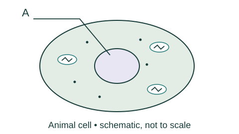
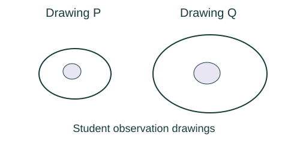
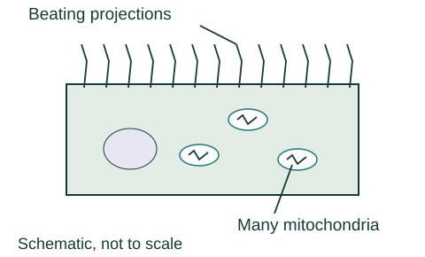
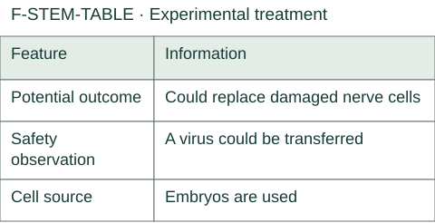
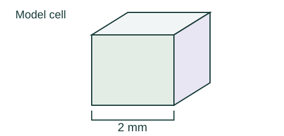
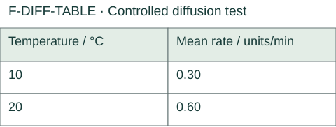
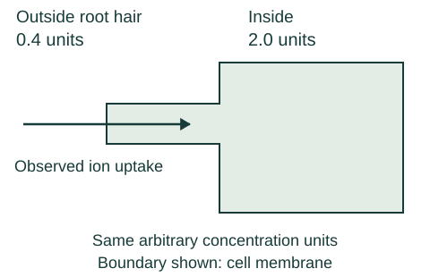
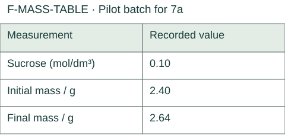

# Foundation A — revised review paper

18 October 2026 · 40 marks · approximately 45 minutes · scientific calculator. Original Study Hub material, not an official AQA paper. Answers and schemes are in the separate marking guide.

## 1a · 1 mark

Which structure is normally present in plant, animal and bacterial cells? Choose one.

- A. Cytoplasm
- B. Nucleus
- C. Chloroplast

## 1b · 2 marks

Figure F-CELL shows an animal cell. Name structure A. State its function.

### F-CELL

**Text alternative:** An oval cell has an outer boundary, a large central oval compartment, smaller ovals with internal folds, and small dots. Leader A ends inside the large central compartment.

Your answer / working: ______________________________

## 1c · 1 mark

Which description fits a bacterial plasmid? Choose one.

- A. A site of aerobic respiration
- B. A small ring of DNA
- C. A membrane-bound nucleus

## 1d · 1 mark

An unknown cell has a cellulose wall and a large permanent vacuole, but no chloroplasts. Which identification best fits? Choose one.

- A. Plant cell
- B. Animal cell
- C. Bacterial cell

## 2a · 1 mark

A microscope has ×4, ×10 and ×40 objectives. Which should be used first to locate a specimen? Choose one.

- A. ×10
- B. ×40
- C. ×4

## 2b · 1 mark

An electron microscope can show two very close structures separately. Name the property that makes this possible.

Your answer / working: ______________________________

## 2c · 3 marks

The recorded image length is 24 mm and the magnification is ×600. Calculate the real cell length in micrometres. Use real length = image length ÷ magnification, and 1 mm = 1000 micrometres. Show working.

Your answer / working: ______________________________

## 2d · 1 mark

The two observation drawings in F-DRAWING are from different specimens. Explain why their displayed lengths cannot be used to decide which cell was really larger.

### F-DRAWING

**Text alternative:** Drawing P is an oval with a smaller oval inside. Drawing Q has a similar layout but occupies more width and height on the page. Apart from P, Q and the observation-drawing caption, no measurements or other labels are printed.

Your answer / working: ______________________________

## 3a · 1 mark

Which statement about a chromosome is correct? Choose one.

- A. Each chromosome carries exactly one gene
- B. A chromosome is made of DNA and carries many genes
- C. A chromosome is made of genes but contains no DNA

## 3b · 2 marks

Before mitosis, a cell grows and increases its sub-cellular structures. Describe what happens to its DNA before mitosis and what happens to chromosomes/nuclei during mitosis.

Your answer / working: ______________________________

## 3c · 1 mark

Which statement about differentiation is correct? Choose one.

- A. All mature animal cells can become any cell type
- B. Differentiation means a cell divides into two identical cells
- C. Many plant cells can differentiate throughout life

## 3d · 2 marks

F-CILIATED shows a cell from an unfamiliar water animal. Its hair-like projections beat to move liquid, and it contains many mitochondria. Explain how the mitochondria help it do this.

### F-CILIATED

**Text alternative:** A cell has many thin projections along its upper surface. The projections beat to move liquid, as stated in the question. Several internal folded ovals are labelled mitochondria. No energy process or function of mitochondria is printed.

Your answer / working: ______________________________

## 4a · 2 marks

State one cell type adult bone-marrow stem cells can form. State how embryonic stem cells differ in the range of cells they can form.

Your answer / working: ______________________________

## 4b · 1 mark

Which description is therapeutic cloning? Choose one.

- A. Mature blood cells are collected directly for transfusion
- B. Adult bone-marrow cells are removed and transplanted without making an embryo
- C. An embryo with the same genes as the patient is produced

## 4c · 2 marks

A research team proposes further work on the treatment in F-STEM-TABLE. Explain one reason to continue the research and one reason it may not be suitable for every patient.

### F-STEM-TABLE

**Text alternative:** Table. Feature; Information. Feature: Potential outcome; Information: Could replace damaged nerve cells. Feature: Safety observation; Information: A virus could be transferred. Feature: Cell source; Information: Embryos are used.

| Feature | Information |
|---|---|
| Potential outcome | Could replace damaged nerve cells |
| Safety observation | A virus could be transferred |
| Cell source | Embryos are used |

Your answer / working: ______________________________

## 5a · 1 mark

Which statement defines diffusion? Choose one.

- A. Net particle movement from higher to lower concentration
- B. Net particle movement from lower to higher concentration using respiration energy
- C. Only water moves through a partially permeable membrane

## 5b · 2 marks

A model cell is a cube with side length 2 mm. Calculate its surface-area-to-volume ratio. Use surface area = 6 × side² and volume = side³. Show working.

### F-CUBE

**Text alternative:** A cube is shown in perspective. One complete side is labelled 2 mm. The drawing is schematic, not to scale. Use the stated value, not a physical measurement of the drawing.

Your answer / working: ______________________________

## 5c · 2 marks

Figure F-GILL shows many thin folds with a good blood supply. Explain how two of these features increase gas exchange.

### F-GILL

**Text alternative:** Several long, thin tissue folds project into surrounding water. A connected blood channel runs inside each fold, separated from the water by a thin tissue boundary. Labels identify water, the boundary and blood channels; no explanation of their effects is printed.

Your answer / working: ______________________________

## 5d · 1 mark

The table gives mean diffusion rates of 0.30 units/min at 10 °C and 0.60 units/min at 20 °C, with all other conditions controlled. Which conclusion is supported? Choose one.

### F-DIFF-TABLE

**Text alternative:** Table. Temperature / °C; Mean rate / units/min. Temperature / °C: 10; Mean rate / units/min: 0.30. Temperature / °C: 20; Mean rate / units/min: 0.60.

| Temperature / °C | Mean rate / units/min |
|---|---|
| 10 | 0.30 |
| 20 | 0.60 |

- A. Diffusion was faster at 20 °C under these conditions
- B. Every 10 °C rise must double diffusion at every temperature
- C. Temperature supplied the respiration energy needed for diffusion

## 6a · 2 marks

Figure F-ION shows mineral-ion concentration 0.4 units outside a root hair and 2.0 units inside, with uptake into the cell. Explain how uptake can continue.

### F-ION

**Text alternative:** The outside concentration is 0.4 units and the inside root-hair concentration is 2.0 units, using the same arbitrary units. The observed uptake arrow points from outside into the root hair, crossing the cell membrane. No process or energy source is named.

Your answer / working: ______________________________

## 6b · 1 mark

Which description of osmosis is correct? Choose one.

- A. Net movement of water from a dilute to a concentrated solution through a partially permeable membrane
- B. Net movement of dissolved ions from a dilute to a concentrated solution through a partially permeable membrane
- C. Net movement of water from a concentrated to a dilute solution through a partially permeable membrane

## 6c · 1 mark

With other conditions unchanged, which change increases diffusion rate? Choose one.

- A. A larger concentration difference
- B. A smaller exchange area
- C. A lower temperature

## 7a · 2 marks

This is a separate pilot batch, not the tissue used for 7b. Use F-MASS-TABLE to calculate the percentage change in mass. Use (final mass − initial mass) ÷ initial mass × 100. Include the sign and show working.

### F-MASS-TABLE

**Text alternative:** Table. Measurement; Recorded value. Measurement: Sucrose (mol/dm³); Recorded value: 0.10. Measurement: Initial mass / g; Recorded value: 2.40. Measurement: Final mass / g; Recorded value: 2.64.

| Measurement | Recorded value |
|---|---|
| Sucrose (mol/dm³) | 0.10 |
| Initial mass / g | 2.40 |
| Final mass / g | 2.64 |

Your answer / working: ______________________________

## 7b · 6 marks

The table and graph show celeriac tissue results. The investigator used one cylinder per concentration, did not blot before final weighing, and used different soaking times. They claim “every plant tissue has no net mass change at 0.40 mol/dm³”. Evaluate the claim. Use the graph and osmosis, then describe how you would improve the investigation to test the claim.

### F-OSM-TABLE

**Text alternative:** Table. Sucrose (mol/dm³); Mass change / %. Sucrose (mol/dm³): 0.00; Mass change / %: +8. Sucrose (mol/dm³): 0.20; Mass change / %: +4. Sucrose (mol/dm³): 0.40; Mass change / %: 0. Sucrose (mol/dm³): 0.60; Mass change / %: −4. Sucrose (mol/dm³): 0.80; Mass change / %: −8.

| Sucrose (mol/dm³) | Mass change / % |
|---|---|
| 0.00 | +8 |
| 0.20 | +4 |
| 0.40 | 0 |
| 0.60 | −4 |
| 0.80 | −8 |

### F-OSM-GRAPH

**Text alternative:** Graph with horizontal axis sucrose concentration in mol/dm³ and vertical axis percentage mass change. The plotted coordinates are (0.00, +8), (0.20, +4), (0.40, +0), (0.60, -4), (0.80, -8). Consecutive points are joined. The corresponding table provides the same data. No intercept value or conclusion is printed.

Your answer / working: ______________________________
