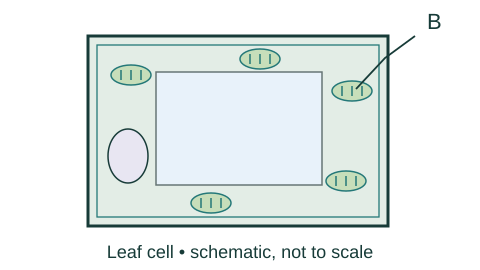
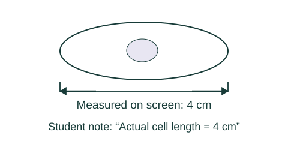
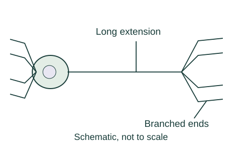
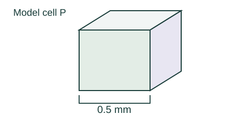
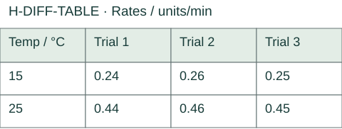
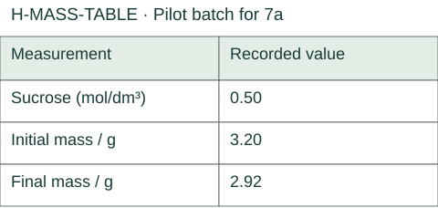

# Higher A — revised review paper

18 October 2026 · 40 marks · approximately 45 minutes · scientific calculator. Original Study Hub material, not an official AQA paper. Answers and schemes are in the separate marking guide.

## 1a · 1 mark

Which structure–function pair is correct? Choose one.

- A. Mitochondria – protein synthesis
- B. Nucleus – aerobic respiration
- C. Ribosomes – protein synthesis

## 1b · 2 marks

Figure H-CELL shows a leaf cell. Name structure B. State its function.

### H-CELL

**Text alternative:** A rectangular leaf cell has a thick outer boundary, an inner boundary, a large pale central region, a smaller oval region to one side, and several green ovals containing stacked marks. Leader B ends inside an upper-right green oval.

Your answer / working: ______________________________

## 1c · 1 mark

Which description fits the main genetic material of a typical bacterial cell? Choose one.

- A. A DNA loop not enclosed by a nucleus
- B. Chromosome pairs enclosed by a nucleus
- C. DNA found only inside mitochondria

## 1d · 1 mark

A bacterial cell is 3 micrometres long and an animal cell is 30 micrometres long. How many orders of magnitude separate these lengths? Choose one.

- A. Two
- B. Ten
- C. One

## 2a · 1 mark

Which procedure is suitable when changing from low to high power after locating a specimen? Choose one.

- A. Use coarse focusing rather than fine focusing after changing to high power
- B. Centre first, then use fine focus
- C. Move the specimen out of view before changing power

## 2b · 1 mark

Explain what higher resolving power allows a microscope to do.

Your answer / working: ______________________________

## 2c · 3 marks

The recorded image length is 72 mm and the magnification is ×24 000. Calculate the real cell length in metres. Give the answer in standard form and show working.

Your answer / working: ______________________________

## 2d · 1 mark

A student writes “actual cell length = 4 cm” by measuring a magnified drawing on a screen. Explain one change needed for a valid size record.

### H-DRAWING

**Text alternative:** An oval-cell drawing has a horizontal measurement line. The recorded displayed length is 4 cm. The student has also written “Actual cell length = 4 cm”. No magnification or calibrated scale is recorded.

Your answer / working: ______________________________

## 3a · 1 mark

Which statement about body-cell genetic material is correct? Choose one.

- A. Chromosomes normally occur in pairs and each carries many genes
- B. All genes occur on a single chromosome in every body cell
- C. Chromosomes are produced only after the cytoplasm divides

## 3b · 2 marks

Explain why the two new nuclei formed by mitosis normally contain the same genes as the original nucleus.

Your answer / working: ______________________________

## 3c · 1 mark

Which comparison of plant and animal differentiation is correct? Choose one.

- A. Differentiation and mitosis always mean the same process
- B. Many plant cells retain differentiation capacity throughout life; most animal types differentiate early
- C. Most animal cells retain unlimited differentiation capacity, but plant cells never differentiate

## 3d · 2 marks

Figure H-NERVE shows a cell transmitting signals from the spinal cord to a foot. It has a long extension and branched ends. Explain how both features help its function.

### H-NERVE

**Text alternative:** A cell body is joined to a long thin extension. The extension ends in several branches. More short branches extend from the cell body. Labels identify the long extension and branched ends, without stating their functions.

Your answer / working: ______________________________

## 4a · 2 marks

Compare the range of cells that embryonic stem cells and plant meristem cells can produce.

Your answer / working: ______________________________

## 4b · 1 mark

Why are stem cells from an embryo produced by therapeutic cloning less likely to be rejected by the patient? Choose one.

- A. Differentiation removes all genetic differences between donors
- B. The embryo has the same genes as the patient
- C. All stem cells from every donor already have identical genes

## 4c · 2 marks

Use H-STEM-TABLE. A nursery claims that meristem cloning guarantees the long-term survival of this rare plant. Evaluate the claim using one evidence-based benefit and one limitation.

### H-STEM-TABLE

**Text alternative:** Table. Feature; Information. Feature: Production; Information: Many identical plants produced quickly. Feature: Existing trait; Information: Current disease resistance is preserved. Feature: Concern; Information: A new disease may affect many genetically uniform clones.

| Feature | Information |
|---|---|
| Production | Many identical plants produced quickly |
| Existing trait | Current disease resistance is preserved |
| Concern | A new disease may affect many genetically uniform clones |

Your answer / working: ______________________________

## 5a · 1 mark

Which statement describes net diffusion at a concentration gradient? Choose one.

- A. No particles can move against the gradient individually
- B. Respiration drives every particle crossing a cell membrane
- C. More particles move down the gradient than up it overall

## 5b · 2 marks

Model cell P is a cube with side length 0.5 mm. Model cell Q has surface-area-to-volume ratio 3:1, measured using mm. Calculate P’s ratio and state how many times as large as Q’s it is.

### H-CUBE

**Text alternative:** A cube is shown in perspective. One complete side is labelled 0.5 mm. The drawing is schematic, not to scale. Use the stated value, not a physical measurement of the drawing.

Your answer / working: ______________________________

## 5c · 2 marks

Figure H-LEAF shows a thin leaf with many air spaces and stomata. Explain how two features make diffusion of carbon dioxide to photosynthesising cells effective.

### H-LEAF

**Text alternative:** A transverse leaf section has upper and lower surface layers, elongated cells near the upper layer and separated rounded cells with air spaces below. A gap in the lower surface is labelled stoma. A leader identifies an internal air space. No exchange explanation is printed.

Your answer / working: ______________________________

## 5d · 1 mark

The table gives diffusion rates at 15 °C: 0.24, 0.26, 0.25 units/min; at 25 °C: 0.44, 0.46, 0.45 units/min, with other conditions controlled. Which conclusion is supported? Choose one.

### H-DIFF-TABLE

**Text alternative:** Table. Temp / °C; Trial 1; Trial 2; Trial 3. Temp / °C: 15; Trial 1: 0.24; Trial 2: 0.26; Trial 3: 0.25. Temp / °C: 25; Trial 1: 0.44; Trial 2: 0.46; Trial 3: 0.45.

| Temp / °C | Trial 1 | Trial 2 | Trial 3 |
|---|---|---|---|
| 15 | 0.24 | 0.26 | 0.25 |
| 25 | 0.44 | 0.46 | 0.45 |

- A. The measurements prove the rate doubles for every future temperature rise
- B. Diffusion stops at the lower temperature
- C. The higher-temperature measurements consistently show a faster rate under these conditions

## 6a · 2 marks

H-GLUCOSE shows glucose uptake from the small intestine into blood. A treatment reduces respiration in the intestinal lining cells; the concentration difference initially stays unchanged. Predict the effect on continued uptake and explain why.

### H-GLUCOSE

**Text alternative:** The overall route goes from small-intestine contents through intestinal lining cells to blood. Glucose concentrations are 1.2 units in the intestine and 4.8 units in blood, using the same arbitrary units. Two arrows show the overall uptake direction. This is not one direct gut-to-blood pump; no process or energy requirement is labelled.

Your answer / working: ______________________________

## 6b · 1 mark

Which statement defines osmosis completely? Choose one.

- A. Net movement of water from a concentrated to a dilute solution through a partially permeable membrane
- B. Net movement of dissolved solute from a dilute to a concentrated solution through a partially permeable membrane
- C. Net movement of water from a dilute to a concentrated solution through a partially permeable membrane

## 6c · 1 mark

Which combination of changes increases diffusion rate when other conditions remain unchanged? Choose one.

- A. Smaller exchange area and lower temperature
- B. Shallower concentration gradient and lower temperature
- C. Larger exchange area and steeper concentration gradient

## 7a · 2 marks

This is a separate pilot batch, not the tissue used for 7b. Use H-MASS-TABLE to calculate the percentage change in mass. Give your answer to one decimal place, including its sign, and show working.

### H-MASS-TABLE

**Text alternative:** Table. Measurement; Recorded value. Measurement: Sucrose (mol/dm³); Recorded value: 0.50. Measurement: Initial mass / g; Recorded value: 3.20. Measurement: Final mass / g; Recorded value: 2.92.

| Measurement | Recorded value |
|---|---|
| Sucrose (mol/dm³) | 0.50 |
| Initial mass / g | 3.20 |
| Final mass / g | 2.92 |

Your answer / working: ______________________________

## 7b · 6 marks

Use H-OSM-TABLE and H-OSM-GRAPH. The investigator used one cylinder per concentration, did not blot before final weighing, and varied soaking time. They claim that every type of plant tissue has no net mass change at exactly the same sucrose concentration. Evaluate the claim. Use an estimate from the graph and osmosis, and propose an improved investigation.

### H-OSM-TABLE

**Text alternative:** Table. Sucrose (mol/dm³); Mass change / %. Sucrose (mol/dm³): 0.00; Mass change / %: +11. Sucrose (mol/dm³): 0.15; Mass change / %: +5. Sucrose (mol/dm³): 0.30; Mass change / %: +1. Sucrose (mol/dm³): 0.45; Mass change / %: −7.5. Sucrose (mol/dm³): 0.60; Mass change / %: −12.

| Sucrose (mol/dm³) | Mass change / % |
|---|---|
| 0.00 | +11 |
| 0.15 | +5 |
| 0.30 | +1 |
| 0.45 | −7.5 |
| 0.60 | −12 |

### H-OSM-GRAPH

**Text alternative:** Graph with horizontal axis sucrose concentration in mol/dm³ and vertical axis percentage mass change. The plotted coordinates are (0.00, +11), (0.15, +5), (0.30, +1), (0.45, -7.5), (0.60, -12). Consecutive points are joined. The corresponding table provides the same data. No intercept value or conclusion is printed.

Your answer / working: ______________________________
